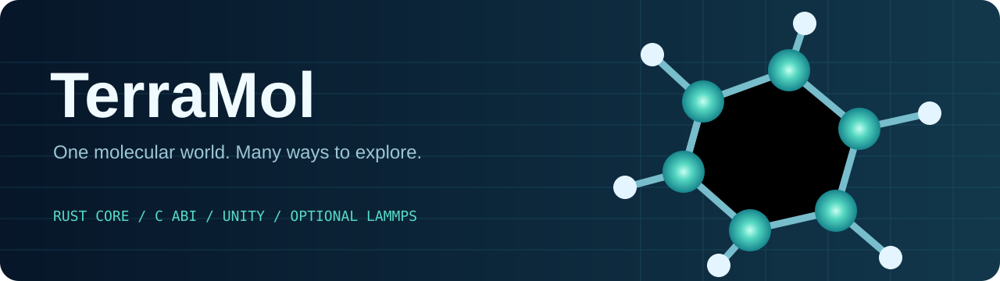
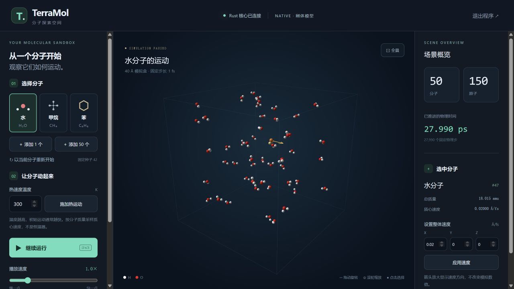
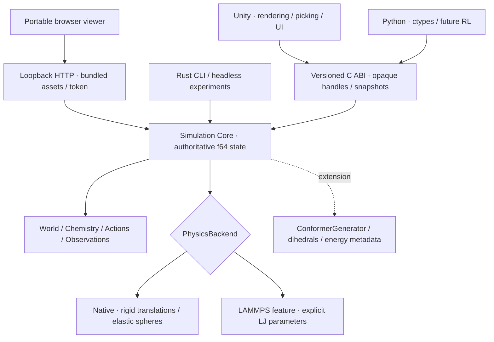

<p align="center"></p>

<p align="center">
  <a href="https://github.com/masterTHou/TerraMol/actions"></a>
  
  
  
  
  <a href="LICENSE"></a>
</p>

<p align="center"><b>双击即可探索的分子世界，以及面向科学计算的 Rust 核心。</b><br>Rust owns the science. Clients own the experience.</p>

## 只想看分子动起来？

**不用安装 Unity，不用安装 Rust、Python 或 Node.js。**

1. 下载 [Windows x64 便携可视化程序](https://github.com/masterTHou/TerraMol/releases/tag/v1.1.0)，选择 **TerraMol-Viewer** ZIP。
2. **全部解压缩**，双击 **启动TerraMol.cmd** 或 **TerraMol.exe**。
3. 浏览器自动打开，立即看到 50 个运动中的水分子。拖动旋转、滚轮缩放，点击原子选中整分子。

支持水/甲烷/苯、混合添加、热运动、速度设置、整分子高亮、速度箭头、暂停、重新开始、
清空和正常退出。程序内置全部网页资源，**不依赖 CDN 或互联网连接**。
首次打开使用 WebGL；图形硬件不可用时自动切换到 Canvas 兼容投影。



完整操作说明：[新手开始](新手开始.md)。当前画面使用 Native 刚体近似，
**不是带有完整力场的原子级 MD**；模型说明在页面中始终可见。

[v1.1 跨平台 CI 全部通过](https://github.com/masterTHou/TerraMol/actions/runs/39032916141)，
包含 Viewer 实际进程测试与 Windows 便携包构建。

TerraMol 是一个长期演进的分子模拟与构象探索项目。`mol_engine_core`
拥有唯一的分子定义、实例、拓扑和模拟状态；Unity 与浏览器只负责显示、输入和 UI。
同一套 Rust API 与版本化 C ABI 为 CLI、Unity 和未来 Python 强化学习入口服务。

**v1.0 是核心原型。** Native 是刚体平动与简化包围球碰撞，不是真实原子级 MD。
可选 LAMMPS 后端执行显式参数的单组分 Lennard–Jones 系统；水、甲烷、苯的
真实动力学尚需力场参数化，后端会明确拒绝这些多原子模板。

## Architecture



| 核心原则 | v1 实现 |
|---|---|
| 一份权威状态 | Rust 内部 f64；Unity 从一致的 f32 快照渲染 |
| 定义与实例分离 | `Arc<MoleculeDefinition>` 共享化学定义；实例持有稳定 ID |
| 可追踪更新 | `topology_version` 控制拓扑重绑定；`state_version` 控制位置更新 |
| 固定物理时间 | `step(N)` 推进 N 个固定步长；渲染帧率不改变积分 dt |
| 可审计跨语言边界 | 固定宽度类型、opaque token、状态码、panic 边界、调用方缓冲区 |
| 物理诚实性 | 近似、参数、支持范围和未验证项明确记录 |

## Developer quick start

需要 Rust stable 与 Cargo。默认后端不需要 Unity、LAMMPS 或 Python，也没有第三方
运行依赖。

```sh
git clone https://github.com/masterTHou/TerraMol.git
cd TerraMol
cargo test
cargo run --example headless
cargo build --release
```

构建便携可视化程序（开发者；发行包用户无需执行）：

```powershell
powershell -ExecutionPolicy Bypass -File scripts/build-viewer.ps1
python tests/viewer_smoke.py TerraMol.exe
python scripts/package-viewer.py
```

macOS/Linux 本地启动：`cargo run --release --features viewer --bin terramol_viewer`。
当前提供预编译的 Windows x64 便携包；其他平台需要自行构建。

无头示例以固定种子放置 50 个水分子，施加 300 K 质心热速度，并推进 1000 个
1 fs 物理步。输出 `50 molecules, 150 atoms`。

| 平台 | 动态库输出 |
|---|---|
| Windows x64 | `target/release/mol_engine_core.dll` |
| Linux | `target/release/libmol_engine_core.so` |
| macOS | `target/release/libmol_engine_core.dylib` |

Windows 实际 DLL 与跨语言测试：

```powershell
python tests/dll_smoke.py target/release/mol_engine_core.dll
python tests/python_headless.py target/release/mol_engine_core.dll
powershell -ExecutionPolicy Bypass -File scripts/test-bridge.ps1
powershell -ExecutionPolicy Bypass -File scripts/install-unity-plugin.ps1
```

打开 `unity/`，使用菜单 **TerraMol → Create prototype scene**，然后 Play。
面板支持水/甲烷/苯、单个/50 个批量生成、整分子选择、删除、清空、设置质心速度、
热运动、暂停和模拟速度。详见 [Unity 使用与验证说明](unity/README.md)。

## Scientific model

统一单位为 **Å · fs · Å/fs · amu · K · kcal/mol**。

- 内置 H、C、N、O、F、S、P、Cl；水 3 原子/2 键，甲烷 5/4，苯 12/12。
- 模板质心归零，保留原始质心、质量及包含范德华半径的保守包围球。
- XYZ 仅包含元素和坐标。共价半径生成候选边，**不能恢复可靠键级或芳香性**。
- 热速度按 `σ² = k_B T / M` 对每个分子的三个质心自由度独立采样。
  不扣除整体动量，不强制把单次样本缩放到精确温度；没有转动/振动热自由度。
- Native 使用空间网格、质量加权弹性冲量、边界反射与有限内部子步。
  包围球碰撞不代表分子势能、氢键、静电或化学反应。
- LAMMPS 使用 `units real`、NVE 和显式 LJ 参数；不从 XYZ 猜测力场。
  详见 [LAMMPS 接口、参数与所有权审计](docs/lammps.md)。

Python 无头入口见 [python/README.md](python/README.md)，跨语言内存契约见
[ABI v1 文档](docs/abi.md)，构象和场景 reset 边界见 [扩展说明](docs/extensions.md)。

## Project map

```text
src/
  chemistry.rs       elements, verified template counts, XYZ candidates
  molecule.rs        shared definitions, instances, stable IDs
  geometry.rs        f64 vectors, rotations, deterministic sampling, box
  world.rs           contiguous atom state, topology, transactional batches
  actions.rs         velocity, temperature, directed flow
  physics/           backend trait, native, optional LAMMPS C API + adapter
  snapshot.rs        read-only versioned render snapshot
  ffi.rs             opaque lifecycle, C ABI, checked buffers, errors
  conformer/         generator contract, dihedral geometry, metadata
  environment.rs     unified actions / observations / repeatable reset
  viewer/            local HTTP transport, fixed-step scheduler, JSON DTOs
  bin/               standalone viewer executable and browser launch
include/             public C header
unity/               thin viewer, pools, picking, controls, scene generator
viewer/              bundled offline WebGL/Canvas UI, no client-side physics
examples/            headless native and parameterized LJ runs
tests/               scientific invariants, ABI, C# bridge, LAMMPS opt-in tests
docs/                architecture decisions, phase log, roadmap, limitations
```

## Verification

```sh
cargo fmt --check
cargo clippy --all-targets --all-features -- -D warnings
cargo test
cargo test --all-features
cargo build --release
```

默认测试覆盖模板、XYZ 错误、空间放置、删除索引、刚体键长、反射、弹性碰撞、
随机种子复现、质量加权热统计、FFI 生命周期及快照布局。C# 独立进程加载实际
DLL，校验同一份 `RustCoreBridge.cs` 的内存布局与调用行为。

**验证状态是交付的一部分。** [阶段记录](docs/phases.md) 区分实际执行、opt-in
测试和环境缺失项。Unity Editor 尚未在本机验证；独立 C# 桥接测试不能替代
Play mode、图形渲染、热重载或 IL2CPP 验证。
[已完成的跨平台 CI](https://github.com/masterTHou/TerraMol/actions/runs/39030938630)
验证了 Windows/Linux/macOS 核心与 ABI，以及 Ubuntu LAMMPS 联调；上方徽章反映最新运行。

## Beyond v1

构象接口与二面角几何操作是扩展契约，**没有完整构象搜索、能量优化或 RL 训练**。
下一步优先建立经过验证的力场参数化和能量接口，再扩展原子级 MD、约束、轨迹、
Python 环境和批量科研实验。[路线图](docs/roadmap.md) 记录阶段边界。

欢迎通过 Issue 提出可复现的科学问题、性能瓶颈和设计建议。贡献前阅读
[CONTRIBUTING](CONTRIBUTING.md) 与 [架构约束](docs/architecture.md)。TerraMol 源码采用
MIT；LAMMPS 是独立的 GPL 项目，使用和再分发须遵守其许可。
